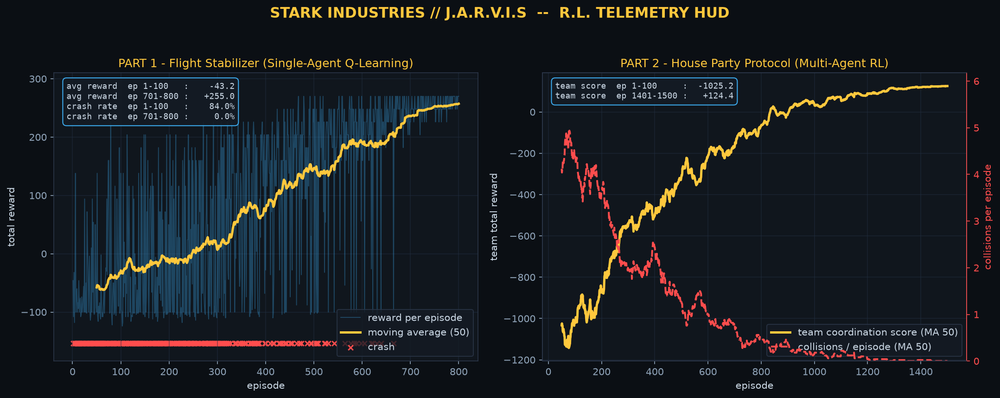
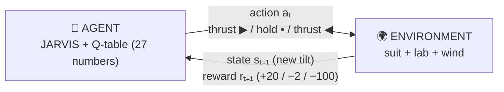

# 🦾 Stark RL Academy — Learn Reinforcement Learning with Iron Man

**Watch three AIs learn to fly Iron Man suits — then understand exactly how, in 10 minutes.**

A complete, zero-magic seminar project: tabular **Q-learning** (single-agent + multi-agent)
in pure `numpy`, wrapped in a story-driven teaching layer, live animations,
and a playable browser game. No ML frameworks, no GPU, runs in ~3 seconds.



---

## ⚡ Quick start

```bash
pip install numpy matplotlib
python stark_rl_simple.py       # 1) the whole algorithm in ~150 lines — read & run this first
python stark_rl_seminar.py      # 2) full seminar: train both parts + live animations + dashboard
python stark_rl_game.py         # 3) bake the browser game  →  open stark_rl_game.html
```

Or start directly from the interactive teaching notebook:
**`stark_rl_academy.ipynb`** (38 cells, one concept per cell).

---

## 🧭 Your learning path

1. **[EXPLAINER.md](EXPLAINER.md)** — the 10-minute mental model: the story, the loop,
   the one formula, the ε trick, the multi-agent magic. *Start here.*
2. **`stark_rl_simple.py`** — the entire Q-learning algorithm in ~150 readable lines.
3. **`stark_rl_academy.ipynb`** — step-by-step chapters with real numbers:
   try the environment by hand → Bellman update by hand → watch the Q-table learn (live).
4. **`stark_rl_game.html`** — play with the trained brains; the in-game **🎓 ACADEMY**
   tab teaches the same lessons interactively (click-through slides + sandbox).
5. **`stark_rl_seminar.py`** — the full seminar script (live HUD animations, multi-agent
   radar, matplotlib dashboard) for presenting on stage.

---

## 🔁 The one picture



Every step: **choose an action → feel the reward → nudge one cell of the Q-table**:

```
Q(s,a)  <-  Q(s,a) + α · ( reward + γ · max Q(s',·) − Q(s,a) )
```

Nothing else in this project is more complicated than that line.

---

## 📈 What the AIs actually learn (seeded, reproducible)

| metric | before training | after training |
|---|---|---|
| **M1** crash rate | 88% | **0%** |
| **M1** avg episode reward | −55 | **+257** |
| **M2** team score | −1022 | **+126** |
| **M2** collisions / episode | 4.3 | **0.0** |
| **M2** team success rate | 0% | **100%** |

Every number above comes from a fixed seed (42) — the live demo can never
embarrass you. And nothing is scripted: every move the AIs make in the
animations and the game comes from `argmax(Q)` of the *actually trained* tables.

---

## 🗂 Project map

| file | what it is |
|---|---|
| `EXPLAINER.md` | 🧠 plain-language introduction — read first |
| `stark_rl_simple.py` | the whole algorithm in ~150 lines (single-agent only) |
| `stark_rl_seminar.py` | full seminar: 2 environments, training, terminal/HUD animations, dashboard |
| `stark_rl_academy.ipynb` | 🎓 teaching notebook — chapters, live Q-formation & policy-arrow animations |
| `stark_rl_live_animation.ipynb` | short "presentation day" notebook (train → watch) |
| `stark_rl_game.py` → `stark_rl_game.html` | self-contained browser game + 🎓 ACADEMY teaching tab |
| `_build_academy_nb.py` | regenerates the academy notebook |
| `stark_hud_dashboard.png` | ready-made slide image |

---

## 🎮 The game (one HTML file, works offline)

`stark_rl_game.html` bakes the trained Q-tables into a Stark-themed arcade:

- **🎓 ACADEMY** — 8 interactive lessons: agent–environment loop, states, a
  *rewards sandbox* where you are the untrained agent, the Bellman update
  revealed number-by-number from real recorded episode-1 steps, the Q-table
  forming as a heatmap, and 3 policy maps organizing from chaos to order.
- **🛩 M1 Flight Stabilizer** — watch J.A.R.V.I.S fly (with a "why this
  command?" teaching line), or fly it yourself with arrow keys and compare
  your score (graded S/A/B/C).
- **🚀 M2 House Party** — 3 independent suits coordinating with no central
  planner; play/pause/step/speed with a live move log.

Deep links for slides: `stark_rl_game.html?m=edu`, `?m=1&speed=4`, `?m=2`.

---

## 🇮🇷 خلاصه‌ی فارسی

پروژه‌ی سمینار «یادگیری تقویتی» با تم آیرون‌من — کاملاً آموزشی:

- **شروع:** [EXPLAINER.md](EXPLAINER.md) را بخوانید، بعد `python stark_rl_simple.py` را اجرا کنید.
- **نوت‌بوک آموزشی:** `stark_rl_academy.ipynb` — هر مفهوم در یک سلول جدا، با انیمیشن شکل‌گیری جدول Q.
- **بازی:** `stark_rl_game.html` را باز کنید — تب **🎓 ACADEMY** همان درس‌ها را تعاملی یاد می‌دهد؛
  در M1 خودتان خلبان شوید و با جارویس مقایسه کنید.
- جزئیات بیشتر و نکات روز ارائه، در ادامه‌ی همین فایل.

---

## ⚙️ Key hyperparameters

| param | value | meaning |
|---|---|---|
| `alpha` | 0.1 | learning rate — how far each experience moves a belief |
| `gamma` | 0.95 | discount — how much the future matters |
| `epsilon` | 1.0 → 0.01 | exploration probability (linear decay) |
| episodes | 800 / 1500 | part 1 / part 2 |

## 🎤 Live-demo notes

- **Fixed seed (42):** every run is identical — nothing random can break the demo.
- **UTF-8:** the scripts force UTF-8 stdout so emojis never crash Windows consoles.
- **Bellman on stage:** the update is commented line-by-line (bilingual FA/EN) right at
  `train_flight_stabilizer` in `stark_rl_seminar.py` — open it on the projector and talk
  through the formula where it actually runs.
- Runtime ≈ 3 s for the full bake; `stark_rl_simple.py` alone is < 1 s.
